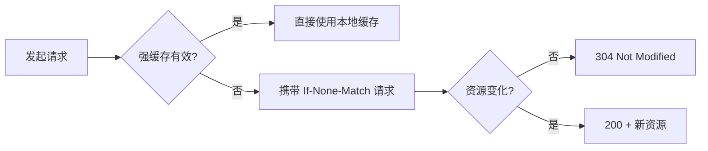

缓存是 Web 性能优化中投入产出比最高的手段，没有之一。但 `Cache-Control` 的十几个指令、`ETag` 与 `Last-Modified` 的优先级关系，常常让人似懂非懂。本文从一个真实静态站的调优过程出发，把这件事彻底讲清楚。

## 一、两种缓存，一个问题

HTTP 缓存分为**强缓存**与**协商缓存**。区别在于：命中强缓存时浏览器根本不发出请求；而协商缓存需要一次往返来确认资源是否变化——没变则返回 `304`，节省了响应体的传输。



> 设计原则：能用强缓存就不要用协商缓存，能用协商缓存就不要回源。每一层都在为下一层减负。

## 二、强缓存：Cache-Control 的正确姿势

对于带内容哈希指纹的静态资源（如 `app.a1b2c3.js`），可以给出近乎永恒的缓存期：

```nginx
# 带指纹的静态资源：缓存一年，immutable 告诉浏览器别再问
location ~* \.(js|css|woff2?)$ {
  add_header Cache-Control "public, max-age=31536000, immutable";
}

# HTML 文档：永不强缓存，永远走协商
location ~* \.html$ {
  add_header Cache-Control "no-cache";
}
```

关键点在于 **HTML 与静态资源要区别对待**：HTML 是引用入口，必须每次确认最新；被引用的资源因为文件名带指纹，可以放心缓存一年。

## 三、协商缓存：ETag 与 Last-Modified

当强缓存失效时，浏览器会带上 `If-None-Match` 或 `If-Modified-Since` 发起条件请求。两者同时存在时，**ETag 优先级更高**——它能感知内容级变化，而非仅仅修改时间。

## 四、一套可直接抄的配置

| 资源 | Cache-Control | 说明 |
| --- | --- | --- |
| HTML | `no-cache` | 每次协商，内容新则 200，否则 304 |
| 带指纹 JS/CSS/字体 | `max-age=31536000, immutable` | 文件名即版本 |
| 图片（CDN） | `max-age=2592000` | 回源加缓存头 |
| RSS / sitemap | `max-age=3600` | 兼顾时效与抓取压力 |

## 五、验证与常见坑

- [x] 强缓存命中的请求显示 `disk cache`
- [x] 协商命中的返回 `304`
- [ ] 千万别给 HTML 加长缓存——用户将永远看到旧文章列表

---

缓存配置是一次投入、长期受益的事情。把它写进部署脚本，之后就再也不需要想它了。
